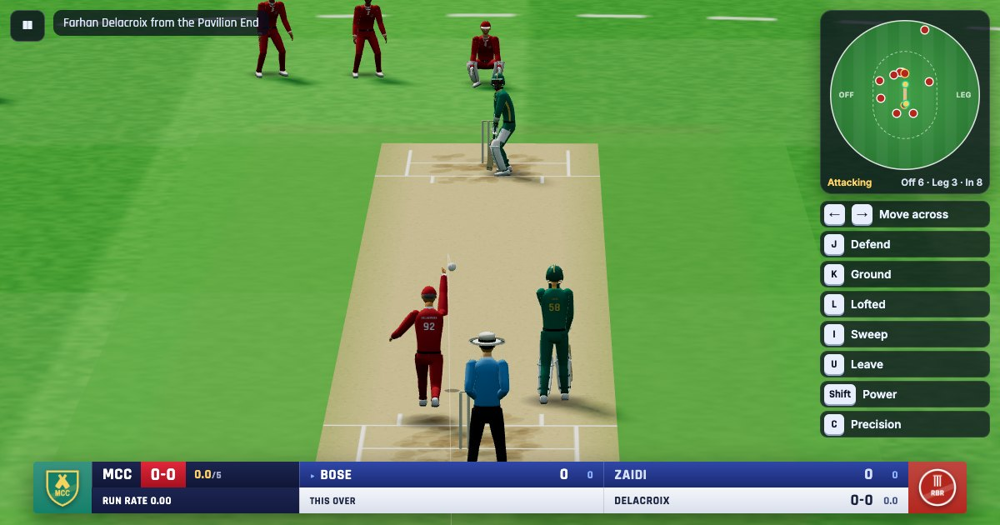

# Low-Poly Cricket

A playable low-poly 3D cricket game in plain HTML, CSS and JavaScript with Three.js. Build a 15-player squad, pick a legal playing XI, and play a 5, 10 or 20-over match or a five-day Test against the computer. You can use the keyboard or a USB/Bluetooth game controller.

**Play online: https://abhi0303.github.io/cricket-game/** (desktop browser recommended: Chrome, Edge, Firefox or Safari).



## Run it

There's nothing to install. The game uses ES modules, so it has to be served over HTTP (opening `index.html` straight from disk won't work):

```bash
python3 -m http.server 8000      # or: npm start
# then open http://localhost:8000
```

Any static server works (`npx http-server -p 8000`, VS Code Live Server, …). Three.js r160 is loaded from the jsDelivr CDN, so you need an internet connection the first time.

### Tests

The cricket rules, squad validation, ball physics, AI, input handling and camera placement are plain JavaScript with no DOM, so they run in Node 18+:

```bash
npm test          # node --test tests/*.test.js
```

There are 151 tests. They cover every squad-composition rule, scoring and extras, Test matches (innings order, stumps and the day's overs, the follow-on, innings wins, chases, ties, declarations, draws on time, the new ball, the Test wide rule, the computer's declarations and Test-like AI scoring), the free-hit switch, DRS (ball tracking's pitching / impact / wickets calls and umpire's-call margins, overturns, reviews kept and lost, three a side per innings, the on-field umpire's accuracy and when the computer reviews), fielding (catches by height, pickups, long barriers, dives only when needed, facing the ball and turning to throw, run-outs taken in the gloves before the stumps are broken), strike rotation, over changes, wickets and the next batter, free hits, bowler over limits, target chasing and results. They also run full AI-vs-AI matches in all three formats (checking that runs, balls and wickets always add up), save/resume mid-match, skipping ahead (simulating an innings, stopping exactly at the final overs of a chase), moving across the crease (keys, reach, pads and stumps, wide calls), the controller layout and shot direction in every camera, sprinting and diving for the crease (only near the line, and no further run after a dive until you call one), net practice (fixed and random speeds, the chosen length, line and delivery always bowled, the netting stopping the ball, and what each shot would be worth on the field), the bowling physics (all 10 speeds × 8 lengths, pitching inside the chosen range, bounce direction, travel and reaction times, identical results at 30/60/120 FPS, nothing passing through the bat, body or stumps), timing windows and shot selection, swing and spin direction, gamepad edge detection, dead zones and connect/disconnect, the batting and bowling camera positions (including the TV framing), the field chart's orientation and counts, every named import between the game's modules, and the batting animations (footwork, contact positions, the bat keeping its speed through the ball, high finishes).

### Publishing on GitHub Pages

The game is a static site with no build step, so GitHub Pages can host it as it is. The workflow in [.github/workflows/pages.yml](.github/workflows/pages.yml) runs the tests and, if they pass, publishes `index.html`, `css/`, `src/` and `assets/` (tests, docs and scripts are left out).

One-time setup:

1. Push the project to GitHub (`main` branch).
2. In the repository, open **Settings → Pages** and set **Source** to **GitHub Actions**.
3. Open the **Actions** tab. The "Deploy to GitHub Pages" run publishes the game to `https://<user>.github.io/<repo>/`; the link is shown on the finished run.

After that, every push to `main` updates the site within a minute or two. You can also re-run it by hand (**Actions → Deploy to GitHub Pages → Run workflow**). A failing test stops the deploy, so a broken build never replaces the live game. GitHub caches pages for up to 10 minutes, so a hard refresh (Ctrl/Cmd+Shift+R) shows a new version straight away.

All paths in the game are relative, so it works from a repository subfolder (`/cricket-game/`) or a custom domain without changes. If you fork it or rename the repository, update the `og:url` and `og:image` addresses in `index.html` (they set the preview shown when the link is shared) and the "Play online" link above.

## How to play

**Menus:** start with **Create My Team** (name, colours, emblem). Then use **Manage Players** to edit the 15 players' names, numbers, roles, styles and ratings, and **Team Strategy** to pick the XI and batting order. **Play Match** opens Match Settings, then the toss.

**Net Practice** (main menu) is batting practice with no match attached: you set up a bowler, then face ball after ball in a green net lane for as long as you like (see [Net practice](#net-practice) below).

### Squad rules (enforced live)

| Rule | Requirement |
|---|---|
| Squad size | exactly 15 |
| Playing XI | exactly 11, each player counted once |
| Designated batting slots | 6: **exactly 3 Attackers, exactly 2 Defensive batsmen, at least 1 All-rounder** |
| Full-time bowlers | at least 5: **2 specialist spinners + 3 fast/medium** (a spinner can't fill a pace slot, or vice versa) |
| Wicketkeeper | exactly 1, and they must also bat as an Attacker or Defensive batsman (keeper-only players don't fit, because all 11 slots are batting or bowling slots) |

All-rounders must have a bowling type and don't count as full-time bowlers. The composition panel shows every count (e.g. `Attackers 3/3`), explains each problem and names the players who could fix it. Start Match stays disabled until the XI is legal. The computer team is generated under the same rules.

### Batting (camera behind you at the striker's end)

| Action | Keyboard | Xbox | PlayStation |
|---|---|---|---|
| Move across the crease | ← / → | D-pad ← / → | D-pad ← / → |
| Shot direction / footwork | WASD (or ↑ ↓) | Left stick / D-pad ↑ ↓ | Left stick / D-pad ↑ ↓ |
| Ground shot (drive, cut, pull, flick, punch) | K | A | ✕ |
| Lofted shot (hook with stick back) | L | B | ○ |
| Precision modifier (hold) | C | X | □ |
| Leave | U | Y | △ |
| Defensive block | J | RB | R1 |
| Advanced: sweep | I | LB | L1 |
| Power modifier (hold) | Shift | RT | R2 |
| Call run | Space | X | □ |
| Send back / cancel run | Q | B | ○ |
| Sprint, both batters (hold) | Shift | RT or LT | R2 or L2 |
| Dive for the crease | E | Y | △ |

On a controller the face buttons do two jobs: while the ball is coming they play the shots (A ground, B lofted, X precision, Y leave); once it's in play they run (X run, B send back, Y dive). The triggers work the same way: RT is the power modifier for a shot, then RT or LT sprints. If you saved your own controller layout before this change, the batting buttons move to this layout once; your keyboard keys are kept.

**Shot direction follows the picture.** Push the stick towards the bowler on screen for front-foot shots and away from him for back-foot shots. Behind the batter that's up and down; in the TV (bowler's end) and umpire views the picture is mirrored, so it's down and up, and left/right are swapped to match as well.

**Sprint and dive.** Holding sprint makes both batters run about 12% faster and pick up speed quicker. A dive only happens near the crease: press dive any time on the way and the batter keeps running until he's about 2.4 m from the line, then lunges full length with the bat grounded out in front, so the bat crosses the line roughly a tenth of a second sooner than running. He never dives mid-pitch. A dive also ends the running: any run you'd queued is cancelled and the batters stay in their ground until you press run again (X on a controller, Space on the keyboard).

**Moving across the crease:** before you play, hold **←** or **→** to shuffle across the crease towards that side of the screen. The batter side-steps there and the field chart shows where you are standing. You can move during the run-up and while the ball is in the air, until you play a shot. The next ball starts from your normal guard again.

- Across to the off side, you can reach balls wide outside off and get in line to drive them. Your pads now cover the stumps, which brings LBW into play.
- Away to the leg side, you make room to hit through the off side, but the stumps are exposed.
- Wides follow the law: a ball you moved across to reach isn't a wide, and backing away can't turn a ball into one.

Push the stick **up** for front-foot shots and **down** for back-foot shots, **right** for the off side and **left** for the leg side. A green arrow shows your aim. Press the shot button just before the ball arrives. The timing bar reports Early / Good / Perfect / Late, and a white ring marks where the ball pitched.

### Net practice

Pick **Net Practice** on the main menu, set up the bowler, then press **Start Nets**:

| Setting | Choices |
|---|---|
| Bowler type | Fast (120–160 km/h), Fast-medium (110–145), Medium pace (95–135), Off-spin (65–100), Leg-spin (65–100) |
| Speed | **Fixed**: every ball at exactly the speed you set (e.g. 145 km/h). **Random**: each ball at a different whole-number speed in the range you set (fast bowlers default to 120–150 km/h) |
| Delivery | Mixed, or one variation every ball: seam up, outswinger, inswinger; off break, arm ball, leg break, googly, flighted, flatter |
| Length | Mixed, or Yorker, Full Toss, Full, Good, Back of a Length, Short of a Length, Short Ball, Bouncer |
| Line | Mixed, off stump, outside off (corridor), wide outside off, middle stump, leg stump |
| Accuracy, swing / turn | Wayward / Steady / Pinpoint; a little / normal / big |
| Difficulty | Easy, Normal, Hard (as in a match), or **Real time** (no slow motion) |
| Batter | Any player in your squad |

"Mixed" uses the computer bowler's own plans, so you get a realistic spread of lengths and variations. The bowler runs in on his own, and the controls are the same as batting in a match (moving across the crease included); there is no running. The stands are empty and the pitch is enclosed in green netting, with side nets, a back net and a roof over the batting half. Hits stop in the netting, and straight drives run out of the open end towards the bowler.

Nothing is scored, but every ball is graded. You see your timing and shot, and what the shot would have been worth against a normal field: four, six, runs, caught, or a diving chance. Bowled, LBW and played-on are given as they happen. A strip along the bottom keeps the session going: balls, runs, fours and sixes, dismissals, the share of shots you middled, and the last eight balls. **Pause → Change bowler** brings on a different bowler, speed or batter straight away; **Leave the nets** shows a session summary. **R** replays the last ball.

The "would have been" result plays the shot out on an open field with the match's own ball flight and fielding rules. The running estimate was fitted to full AI matches: over about 3,000 shots its total runs come within 2% of what the real fielders and runners gave.

### Reviews (DRS)

Each side has **3 reviews per innings** for LBW decisions. A review is lost when the on-field decision is clearly right; it is kept when the decision is overturned or stays on **umpire's call**.

- **The on-field umpire:** judges LBWs by eye. He gets nearly all of them right and gives the batter the benefit of the doubt, but a close call occasionally goes the wrong way.
- **When you can review:** if your batter is given out LBW, or your LBW appeal is turned down while bowling, you're asked to **Review (DRS)** or accept the decision. You have 7 seconds, and the controller uses the usual menu buttons. The computer reviews for its own side, mostly when a decision was wrong, sometimes gambling on a close one, and more carefully with its last review.
- **The review:** the third umpire watches the replay to the pad, then ball tracking draws in:
  - the stump-line corridor down the pitch and the ball's path (red);
  - **PITCHING:** in line, outside off or outside leg;
  - **IMPACT:** in line, umpire's call or outside (no defence outside off if no shot was offered);
  - the projected path on to the stumps (blue) and the wicket zone;
  - **WICKETS:** hitting, umpire's call (less than half the ball hitting) or missing.

  Then the decision: OUT or NOT OUT, with "decision overturned", "umpire's call" or "on-field decision stands", and whether the review was kept. **Continue** skips to the decision.
- **The result:** a batter given out on review scores no runs off that ball, and a reprieve wipes the dismissal. Reviews left for both sides show under the caption at the top left (`DRS MCC ●●○ · RBR ●●●`).

In AI-vs-AI testing, about 5% of dismissals are LBW. Of 37 LBW appeals, the umpire got 32 clearly right, 4 were umpire's call and 1 was a wrong decision that a review would overturn.

### Test matches

Pick **Test match (5 days, 90 overs a day)** as the format in Match Settings.

- **Innings:** two each, with no over limit. An innings ends when the side is all out or declares. The fourth innings chases a target.
- **Days:** a day is 90 overs, ending at stumps after the over in progress. Ten minutes (two overs) are lost at each change of innings. Lunch and tea are noted on screen, and bowlers are rested overnight.
- **Results:** a win by runs or wickets, a win by an innings, a tie, or a draw when time runs out at the end of day 5.
- **Follow-on:** a side 200 or more behind after the first innings can be made to bat again straight away. When you're ahead you choose; the computer enforces it with a lead of 260 or more, or when time is short.
- **Declare:** use **Pause → Declare** while batting in any of the first three innings. The computer declares when its lead is out of reach in the overs left, or after a very big first-innings total.
- **Other Test rules:** no free hits, no limit on a bowler's overs (just no two in a row), a new ball after 80 overs, and wides called only when the ball is clearly out of reach.
- **Look:** both sides wear cream whites (team colour on the trim, cap and helmet) and play with a red ball in front of white sightscreens.
- **Skipping ahead:** **Pause → Skip ahead** simulates to stumps, to the end of the innings, or to the result. The stumps screen offers the same, and the innings-break screen lets you play, watch, or simulate.
- **Bowling choice:** **Captain picks the bowlers** on the bowler-choice screen lets the computer choose your bowler each over for the rest of the innings while you still bowl.

The computer bats like a Test side: patient, leaving balls outside off, picking up the pace only when chasing quickly or setting up a declaration. In AI-vs-AI testing a Test innings averages about 290 runs in 90 overs (3.3 an over), with a wicket every 60 or so balls. Most Tests run into day 4 or 5, with wins by runs, wickets and an innings all turning up.

**Free hit after a no-ball** can be switched off for limited-overs matches in Match Settings. Tests never have free hits.

### Bowling (camera behind your bowler)

Pick a **speed** with **E / Y / △** (faster) and **Q / B / ○** (slower): 150, 145, 140, 130, 125, 115, 100, 95, 85 or 70 km/h. Which speeds are available depends on the bowler's type, pace rating and tiredness. Pick a **length** with **L / RB / R1** and **O / LT / L2**: Yorker, Full Toss, Full, Good, Back of a Length, Short of a Length, Short Ball or Bouncer. A yellow band shows where that length pitches. The stick moves the marker within the band (up/down) and changes the line (left/right). **K / X / □** changes the variation: seam or out/inswing for pace; off/leg break, arm ball/googly, flighted or flatter for spin. **Hold J / A / ✕** to run in, and **release** in the green zone of the meter. Releasing too late oversteps for a no-ball. **Shift / RT** adds pace at the cost of accuracy and stamina. At the start of each over you pick the bowler (fatigue and over limits are shown) and the field.

**Fielding:** catches and stops are automatic. When your fielder gathers the ball while the batters are running, time slows down and you choose the throw: keeper's end (J / A), bowler's end (L / B) or best end (K / X).

**Cameras:** batting has five views: behind the batsman (standard, low or high), the bowler's end (TV broadcast) and the umpire's eye at the bowler's end. The TV broadcast view copies television coverage: a long lens from high behind the bowler's arm, with the keeper and slips along the top, the batter a third of the way down and the bowler and umpire just above the score strip. Bowling has three: behind the bowler, behind the bowler (high) and the batsman's end. Choose them in Match Settings or in **Pause → Settings**, or cycle them during play with V / View / Share. From the bowler's-end views the picture is mirrored, so the left/right shot direction is flipped to keep "right" meaning screen-right.

**On screen:**
- **Field chart (top right):** a live map of the ground with every fielder, both batters and the ball in play. It shows the field setting and how many fielders are on the off side, on the leg side and inside the circle. It turns with your camera, so a gap on the right of the chart is on the right of the screen, which is where pushing the stick right sends the ball.
- **Controls:** a small card under the chart lists the buttons for what you're doing right now (batting, running, bowling, fielding or between balls). Turn it off with **Button hints** in Match Settings or **Pause → Settings**.
- **Score strip (bottom):** a two-row strip like TV coverage. It shows both team badges, the score and overs, the run rate or "need X from Y balls", the striker (▸) and non-striker with runs and balls, this over ball by ball, and the bowler's figures.

**Auto-play and skipping ahead:**
- **Auto-play** (in the pause menu, and on the choose-your-bowler screen) lets the AI bat or bowl for you while you watch. Pause again and choose **Take back control**. The switch happens between balls.
- **Skip bowling** (same places, while you're bowling) simulates instantly with the score ticking over. **Stop here and play** takes over from the current ball.
  - In the first innings it finishes the opposition's innings.
  - In a chase you choose: **Watch the final overs**, **Bowl the final overs**, or **Simulate to the result**.
- The finish of a chase is the last 1/2/3 overs (5/10/20-over games), a target that's within that many balls, or the last two wickets.
- At the innings break you choose how to play the second innings.
  - Chasing: **Start the chase**, **Jump to the final overs** (the AI bats until the finish, then you take over), **Watch the chase** or **Simulate to the result**.
  - Defending: **Defend the total**, **Watch the final overs**, **Bowl the final overs** or **Simulate to the result**.

**Pause and scorecard:** the pause menu shows a match summary next to the options: the score and situation, both batters, the partnership, the last wicket, the bowler's figures and this over. The scorecard has a tab for each innings, with the team band, batting (how out, runs, balls, fours, sixes, strike rate), extras and total, who's yet to bat, the fall of wickets and the bowling figures. The current batters, the top scorer and the best bowler are highlighted.

**Anywhere:** Esc / P / Start pauses (Pause → Settings has cameras, sound, replays, aim marker, running and button hints), V / View changes the camera, R / Y replays the last ball, and Enter / A continues. Every binding can be remapped in **Controls & Tutorial**. Controllers are detected on connect, button hints switch between Xbox and PlayStation symbols, and play pauses if a controller disconnects. The keyboard always works.

## What's simulated

- **Players:** each player's role, batting style (Attacker / Defensive / Balanced), technique (front-foot, back-foot, balanced, sweeper), bowling type (fast, fast-medium, medium, off-spin, leg-spin) and nine 1–99 ratings feed directly into gameplay: timing windows, edge and miss risk, shot power, pace, swing and turn, accuracy, stamina, running speed, catching and throwing. In AI-vs-AI testing, attackers strike at about 200 and get out roughly twice as often as defensive batsmen, who strike at about 85.
- **Ball physics:** the selected speed sets the release velocity (km/h ÷ 3.6), and a drag-aware solver aims the arc at the chosen pitching point. Gravity, air drag and swing act in flight; the bounce contact is exact, with restitution and speed loss set by the length, then seam and turn off the pitch. There's also drag on hit balls, bounces and roll on the outfield, and fours versus sixes at the rope. A perfect shot isn't a guaranteed six: the shot choice, the line and length, the player and the field all matter.
- **Dismissals:** bowled (including played on), caught (fielders, caught behind, caught and bowled), LBW (judged by the on-field umpire, reviewable with ball tracking), run out at either end, stumped (dancing down to a spinner) and the rare hit wicket.
- **Fielding:** fielders run to cut the ball off and take it the way a player would. Catches are taken above the head, at the chest or low on bent knees. Slower ground balls are picked up with a bend and both hands, and hard ones straight at a fielder get a long barrier on one knee. They dive, to the correct side, only when that's the only way to stop a boundary or reach a catch, which is about one ground stop in six; before this change it was three in four. The take starts just before the ball arrives so the hands meet it, the ball then sits in the fielder's hand, and he straightens up, turns to the stumps and throws from the hand. At the stumps the keeper (or bowler) takes the throw in the gloves, the ball stays in his hands, and he goes down to the stumps with it; the bails come off when his gloves reach them, so a batter who makes their ground in that moment survives. A direct hit flies into the stumps and knocks them over, and if the batter was in, it comes off the stumps into the field. A keeper standing up can't catch a ball pushed forward past the batter.
- **Rules:** legal balls and overs, wides (off side, down leg, over head height; wider in Tests), front-foot and waist-high no-balls with free hits (optional; never in Tests), byes and leg byes, strike rotation, new batters (including the caught-batter rule), bowler limits (one fifth of the overs each, no consecutive overs), all out / overs / target reached, ties. Tests add four innings, days and stumps, declarations, the follow-on, innings victories, draws and the new ball.
- **Computer:** chooses shots by expected runs against wicket risk, reacting to the required run rate, wickets left and the phase of the innings. Its bowling plans depend on the batter and the situation, and its field settings and bowler rotation are rule-based. Running decisions include small misjudgements, so run-outs happen. Difficulty changes reaction-time pressure, timing windows, aim assist, accuracy and how well the computer bats, bowls and catches.

In AI-vs-AI testing at Normal, a T20 averages around 170/6 at about 9 an over, with roughly 16 fours, 5 sixes, 3–4 wides and 1 no-ball per innings. Dismissals split about 62% caught, 22% bowled, 7% LBW, 4% run out, 3% stumped.

## Project layout

```
index.html, css/style.css
src/main.js                     bootstrap + main loop
src/game/
  PlayerAttributes.js           roles, styles, ratings, XI slot categories
  TeamManager.js                squad generation, validatePlayingXI(), validateSquad(), auto XI, batting order
  CricketRules.js               applyBall(): the only place runs/balls/wickets are counted
  MatchEngine.js                toss, innings, target, bowler rules, fatigue, result, save/resume (JSON)
  PhysicsConfig.js              every bowling/ball physics value: speeds, lengths, bounce, drag, zones
  BallPhysics.js                delivery planning (release solver, drag, exact bounce, timings) + batted-ball flight
  ShotModel.js                  input -> shot, timing windows, suitability, edges, launch
  DeliverySim.js                one ball from run-up to dead ball: pads/LBW, fielding, throws, running
  FieldPlacements.js, Difficulty.js, MatchSim.js (engine <-> sim glue), SkipSim.js (auto-sim / skip ahead)
  MatchController.js            the match you play: input profiles, cameras, HUD, replays, overlays
  NetsConfig.js, NetsSim.js, NetsController.js   net practice: bowler set-up, the net delivery, the session
  BattingInput.js               the human batter's controls (shared by matches and the nets)
  GameManager.js, DemoController.js (menu background match)
src/ai/CaptainAI.js             Test captaincy: when to declare and whether to enforce the follow-on
src/ai/                         BattingAI, BowlingAI (deliveries, bowler choice, fields), FieldingAI
src/controls/                   Bindings, KeyboardControls, GamepadControls, InputManager
src/scene/                      StadiumScene, NetArea (green practice nets), BallLook (stitched ball and wear), BatLook (bat stickers),
                                Environment, PlayerModel, Animations, MatchView,
                                CameraManager + CameraPoses, Textures, GeoBuilder, Renderer,
                                PhysicsDebug (developer overlay),
                                CharacterGeometry (sculpted, skinned player meshes and kit),
                                CharacterShowcase (?debug=characters line-up)
src/ui/                         Screens (menus), HUD + overlays, FieldMap (field chart), NetsForm (nets bowler set-up), Emblem, UI helpers
src/audio/Sound.js              procedural Web Audio effects (no audio files)
assets/preview.jpg              link-preview image (not loaded by the game)
tests/                          node:test suites
scripts/physicsReport.mjs       speed x length report vs the 20.12 m baseline (npm run physics-report)
docs/bowling-physics.md         physics formulas, configuration and the full timing table
.github/workflows/pages.yml     test + deploy to GitHub Pages
```

**Design notes:**
- Gameplay and visuals are separate. `DeliverySim` is deterministic given its seed and owns the truth for the ball. `MatchView` only draws what it reports, and scoring only happens when the sim's final ball record goes through `MatchEngine.recordBall()`. Skipping or interrupting animations can't change the score.
- Physics runs in a "delivery frame" with the striker at +z. When the ends change, the scene rotates that frame 180°, so the batting camera always sits at the striker's end and the bowler always delivers from the opposite end.
- Everything is procedural (low-poly models, canvas textures, synthesized sound), so the game loads no asset files.

**Performance:** static stadium geometry is merged into a handful of vertex-coloured meshes and the crowd is two instanced meshes animated in a shader. A match frame is about 140 draw calls and about 110k triangles. The Graphics setting controls resolution, shadows, crowd density and a 30 fps cap on Low.

## Bowling physics

The full write-up is in [docs/bowling-physics.md](docs/bowling-physics.md): formulas, configuration, and every speed × length compared with the 20.12 m constant-speed baseline.

At 145 km/h, for example:

| Delivery | Release → pitch | Reaction after bounce | Total travel | Baseline | Height at batter |
|---|---:|---:|---:|---:|---:|
| Yorker | 0.477 s | ~0 (pitches inside the hitting zone) | 0.494 s | 0.500 s | 0.11 m |
| Good Length | 0.302 s | 0.143 s | 0.524 s | 0.500 s | 0.64 m |
| Short Ball | 0.150 s | 0.351 s | 0.586 s | 0.500 s | 1.47 m |
| Bouncer | 0.150 s | 0.355 s | 0.591 s | 0.500 s | 1.67 m |

A 70 km/h full toss takes 1.03 s to arrive, more than twice as long as a 150 km/h yorker.

**Developer debug mode:** open `http://localhost:8000/?debug=physics`; F8 hides or shows it. It displays the selected speed and length, the actual pitching point, release → pitch, pitch → stumps, reaction time, total travel against the baseline, live horizontal and vertical velocity, and bounce height. It also draws the trajectory line, the pitching and release points and the hitting zone, and unlocks all ten speeds for every bowler. Normal players never see it.

## Characters

Every player is one skinned mesh on a shared 17-bone skeleton: hips, spine, chest, neck, head, and shoulder, elbow, wrist, hip, knee and ankle on each side. Each body part is lofted from anatomical cross-sections, and vertices near a joint are weighted to both bones so elbows and knees bend smoothly. The mesh geometry is generated once per kit and shared between players.

- **Kit:** full-sleeve shirts with collars and cuffs, matching trousers with a side stripe, and studded boots. Materials are physically based: matte cloth, satin skin, glossy helmets and metal grilles, with baked shading in the creases and a soft contact shadow under each player.
- **Batters:** helmet with grille, gloves with padded fingers, tall ridged pads with coloured straps, arm guard, thigh guard, and a shaped bat. The bat has a ribbed rubber grip in the team colour and a willow blade with grain, darker edges and a rubber toe guard. It carries the maker's stickers (MRF or SG, depending on the player): a small one at the shoulder and a large one near the toe on the face, and a long one down the back. The lettering is drawn in the game's own style, not taken from the real logos.
- **Keepers:** big webbed gloves and pads; a cap when standing back, a helmet when standing up to spinners.
- **Fielders and bowlers:** team cap and bare hands with fingers. The bowler holds the ball in the hand.
- **Umpires:** blue shirt, black trousers and a wide-brimmed hat.
- **Team kit:** colours, side panels, a chest emblem, and the player's name and number on the back. In Tests both sides wear cream whites, with the team colour kept for the trim, name, cap and helmet.
- **The ball:** stitched leather, red in Tests and white otherwise. It has a raised main seam with six rows of stitching, faint quarter seams and a small gold maker's stamp, and new leather has a polish. As the ball gets older (over 80 overs for a red ball, about 25 for a white one) it loses its shine and picks up light scuffs, specks of mud and the odd grass mark. It spins in flight: backspin with the seam upright for pace, turning about its line of flight for spin, tumbling off the bat and rolling on the grass.
- **Variety:** each player gets a seeded height, skin tone, hairstyle and facial hair.

Animations include separate fast, medium and spin bowling actions, every batting shot, a play-and-miss reaction, running, the batter's dive for the crease, fielding (ready, chase, high / chest / low catches, two-handed pickup, long barrier, left and right dives, throw, celebrate), keeping (crouch, take, stumping) and the umpire signals (out, not out, four, six, wide, no ball, bye).

**Replays** (automatic after wickets and boundaries, or **R** between balls) play the delivery from behind the bowler, from just before the delivery stride, then cut to a slow-motion second angle:

- **Bowled:** a low view of the stumps.
- **LBW:** side-on at pad height.
- **Catches and boundaries:** a camera following the ball.
- **Run-outs and stumpings:** side-on at the crease.

The stumps are whole at the start of each angle and break at the moment the ball hits, with the bails flying in slow motion. A **● REPLAY** tag shows which angle is playing.

### Batting animation

- **Stance and routine:** the batter waits side-on with knees flexed, a slight bend at the hips, head level and turned to the bowler, and hands low in front of the back thigh. The bat rests just in front of the back toe and he taps it on the crease two or three times, then pauses, while the bowler runs in. About 0.75 s before release he picks the bat up: hands to the waist by the back hip, the bat roughly level and pointing back at the keeper with the face open. From there it goes up into the backlift as the ball is released.
- **Footwork:** batting clips place the feet, and two-bone leg IK plants them. Front-foot shots stride towards the ball with the knee bent, the head over the front knee and the back heel coming up. Back-foot shots go back and across. The sweep goes down on the back knee.
- **Swing:** each shot is keyframed through backlift, downswing, contact, follow-through and finish. The keys are joined by a smooth spline, so the bat travels in a curved arc and keeps its speed through the ball instead of stopping at each key. Drives come down vertically and finish high over the front shoulder. The pull and hook turn the hips and roll over the ball. Defensive shots hold a dead bat.
- **Arms:** both hands stay on the handle through arm IK with authored elbow directions (a high front elbow on drives). If a pose puts the bat out of reach, the bat is drawn in towards the shoulders rather than the hands leaving it.
- **Contact:** when a shot starts, the game works out where the ball will be at contact. It nudges the swing (and the body's lean) so the middle of the bat meets it. In testing, clean contacts land within about 3 cm. When the game decides the ball beat the bat, the bat is pulled off the line, and edges move it slightly to the inside or outside.
- **Stability:** during a shot the batter stays anchored at the crease. The clip moves the body, so nothing jumps when the run starts.

A match frame is about 110 draw calls. Characters are about 9.5k triangles each (13k for a batter with helmet and bat), or about 5.4k (8.2k) on Low graphics. Animating and solving the IK for all 15 players takes about 0.15 ms per frame.

To inspect them, open `/?debug=characters` (developer tool) with `&view=front|back|side|three|face|bat`, the batter views `bbehind|bside|bfront|bpoint`, and optionally `&anim=<clip>&t=<seconds>&only=0`. Add `&ball=x,y,z&aim=1` to put a ball in the first batter's space (+x towards the bowler, +z the off side) and steer the shot onto it, the same way the match does.

## Known limitations

- All batters are right-handed and all bowlers bowl right-arm over the wicket.
- There's no Super Over (a tie stays a tie), no DRS, no powerplay fielding restrictions, and no overthrows beyond the occasional wild throw.
- Fielders catch and stop the ball automatically. You only control the throw.
- Players are procedural low-poly models. There's no GLTF loading yet, though `PlayerModel` is the single place to swap one in.
